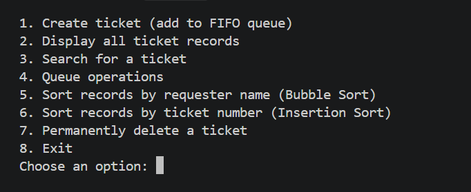
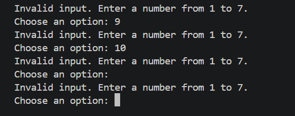
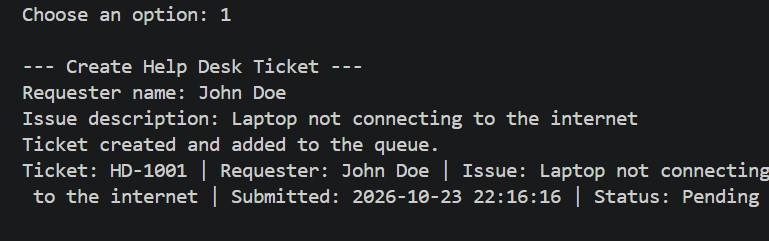
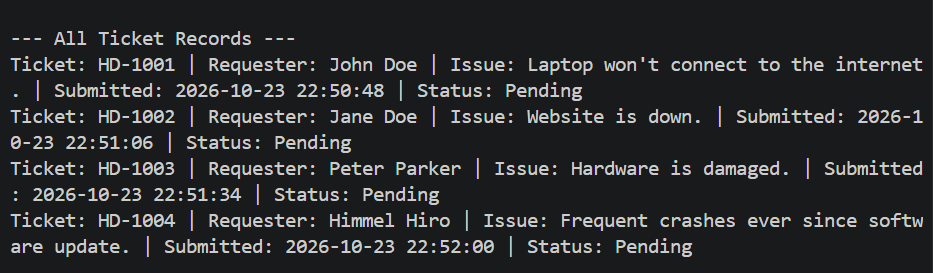
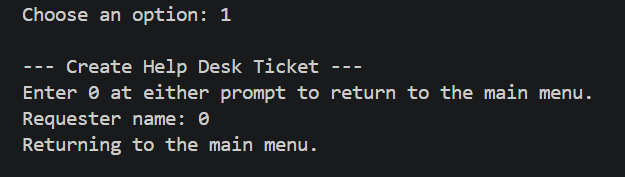

# IT Help Desk Ticketing System

## Project Description

The IT Help Desk Ticketing System is a console-based Java application for recording and managing technical-support requests. New tickets are added to a first-in, first-out (FIFO) queue so the oldest waiting request is handled first. Staff can also search and sort the ticket records without changing the queue's processing order.

## Objectives

- Demonstrate two manually implemented sorting algorithms on useful ticket data.
- Use a Java queue to enqueue, peek at, display, and process help desk tickets in FIFO order.
- Store ticket information in synchronized `ArrayList` collections.
- Apply procedural methods, loops, conditional statements, and input validation.
- Integrate ticket records, searching, sorting, and queue operations in one console application.

## Use Cases and Features

- Create a ticket with a requester name and issue description.
- Automatically assign a unique ticket number and submission timestamp.
- Add each new ticket to the waiting queue.
- Display all ticket records, including their status.
- Search for a ticket using its number (for example, `HD-1001` or `1001`).
- Display the waiting queue in FIFO order.
- Peek at the next ticket without removing it.
- Process the next ticket, marking it as processed.
- Sort ticket records by requester name or ticket number.
- Save ticket records locally and reload them on the next launch.
- Reject blank ticket details and invalid menu or ticket-number input with clear messages.
- To return to the main menu, enter `0` at a ticket creation or search prompt, or choose `0` in the Queue Operations menu. Display and sort actions return to the main menu automatically when complete.
- Handle empty record lists and empty queues without terminating unexpectedly.

## Data Structure Explanation

Ticket records are stored in five `ArrayList`s:

- `ticketNumbers`
- `requesterNames`
- `issueDescriptions`
- `submissionTimes`
- `ticketStatuses`

The values at a given index in all five lists describe the same ticket. The sorting methods swap every field at that index together to keep records synchronized.

The waiting queue is a `Queue<Integer>` backed by `ArrayDeque<Integer>`. It contains ticket numbers in arrival order, not copies of ticket records. Queue display and peek operations use each queued number to find its record. Processing removes only the queue's head ticket and marks that ticket as processed. Sorting changes the order of records in the `ArrayList`s, but never changes the queue.

Ticket records are saved to `tickets.txt` in the directory where the program is launched. The file is updated when a ticket is created or processed and loaded on startup. Pending tickets are restored to the queue in ticket-number/arrival order, even if the record lists had been sorted before the application closed. The data file is excluded from Git so local ticket details are not accidentally committed.

The application uses only static methods and built-in Java data types and collections for its procedural logic. It does not define custom ticket/entity classes or use custom objects.

## Sorting Algorithm Explanation

Both algorithms are implemented directly in `Main.java`; no built-in sorting methods are used.

### Bubble Sort — requester name

Bubble Sort compares adjacent requester names without regard to letter case and swaps records when they are out of order. It is a straightforward way to demonstrate sorting a small set of help desk records alphabetically. Its average and worst-case time complexity is O(n²); the implementation stops early if a pass makes no swaps.

### Insertion Sort — ticket number

Insertion Sort places each ticket number into its proper position among the preceding records. It demonstrates ordering the records by their numeric ticket identifiers. It has O(n²) average and worst-case time complexity and performs well on small or nearly sorted lists.

Each sort displays the records before and after sorting. Since each sort swaps the fields in all five record lists together, ticket details remain associated. The separate FIFO queue is unaffected.

## How to Run the Program

Install a Java Development Kit (JDK) version 8 or later. From the project root, compile and run:

```text
javac -d out src\Main.java
java -cp out Main
```

On macOS or Linux, use forward slashes for the source path:

```text
javac -d out src/Main.java
java -cp out Main
```

Select a menu option by entering its number. Creating a ticket automatically enqueues and saves it. Choose **Queue operations** to display the waiting list, peek at the next ticket, or process it. Processed status is saved immediately. On later launches, the application reloads saved tickets and restores pending tickets to the queue.

## Screenshots of the System

### Main Menu



*The running application’s main menu and available operations.*

### Input Validation



*Out-of-range and non-numeric menu entries are rejected without exiting the application.*

### Creating a Ticket



*A ticket is assigned an ID and submission time, then added to the waiting queue with Pending status.*

### Displaying Ticket Records



*Stored records show each ticket's number, requester, issue, submission time, and status.*

### Additional Required Screenshots

Add readable screenshots captured from the running application for:

- Queue operations, including queue display, peek, and processing/dequeue.
- FIFO behavior, showing tickets processed in the order they were added.
- Bubble Sort by requester name, showing records before and after sorting.
- Insertion Sort by ticket number, showing records before and after sorting.

Save each screenshot in the `screenshots/` folder and add it here with a short caption. Use actual program output, not mockups.

### Returning to the Main Menu



*Entering `0` cancels ticket creation or a ticket search and returns to the main menu. The same return choice is available in the Queue Operations menu; display and sort actions return automatically when complete.*
